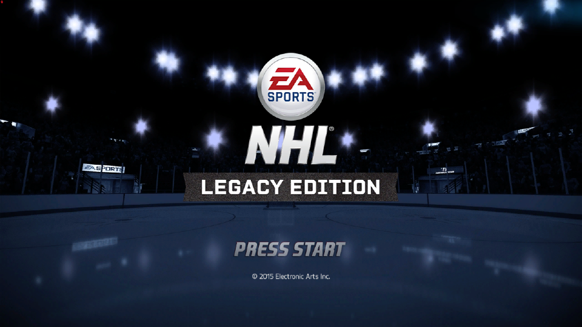
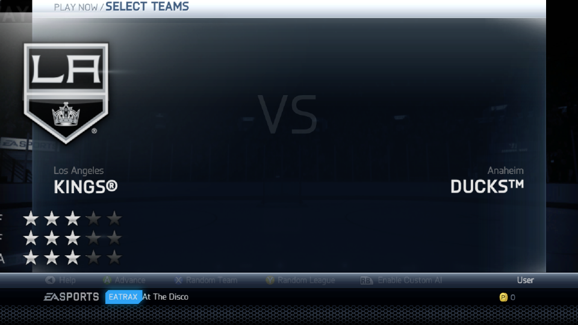
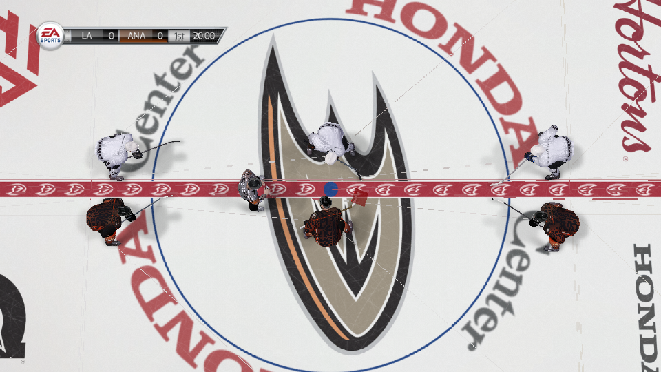
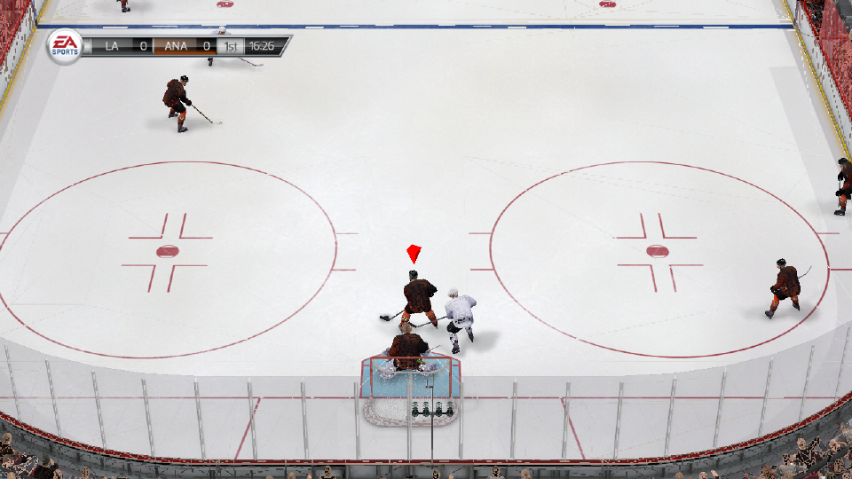

# NHL Legacy Recomp (fork: native Linux, iGPU performance, tools)

A native **PC port of NHL Legacy** (Xbox 360) produced by static recompilation: the game's code is translated
to a native executable with [RexGlue](https://github.com/rexglue/rexglue-sdk) instead of being emulated, with a
Vulkan renderer on top.

> **You must provide your own legally obtained copy of the game.** This repository contains **no game content**
> of any kind (no `default.xex`, no archives, textures, databases, rosters, music or recompiled sources) and none
> will be provided. Piracy is not condoned. This project is not affiliated with or endorsed by EA or Microsoft.

## Original project and this fork

The port, the installer/builder, the Windows and macOS builds and the Vulkan/D3D12 renderer work come from
[puckhead73/nhl-legacy-recomp](https://github.com/puckhead73/nhl-legacy-recomp) (macOS work by Redth). This fork
([erik-131/nhl-legacy-recomp](https://github.com/erik-131/nhl-legacy-recomp)) keeps all of that and adds:

| Area | Original | This fork |
|---|---|---|
| Platforms | Windows (native), macOS, Linux via Proton | **Native Linux (ELF) build**, no Proton or Wine; Windows and macOS code paths kept |
| GPU speed on an Intel Arc iGPU, 1280x720 | about 8-10 fps (Vulkan with fragment-shader-interlock EDRAM) | **about 100 fps median in play** (see Performance) |
| Streaming | - | Setup and tooling for Games on Whales / Wolf + Moonlight, headless benchmark lobbies |
| Startup | about 44 s to the EA logo without a pad | **Quick start**: main menu in about 10-12 s |
| Menus and settings | In-game ImGui overlay | **Pre-game menu** (SDL, gamepad-driven; off by default) |
| Mods | loose files under `game/` | **Mod layers** (`mods/`), **art** (.rx2) tool, **Lua** findings |
| Rosters and data | - | Database and localisation tools, **2026-27 rosters pipeline**, **32 teams** (Seattle, Vegas) |
| Rules | - | **Rule hooks**: 3v3 / 4v4, period length (opt-in) |
| Source-level control | - | Study and first readable-C++ modules (**L1 / L2**, proposal P22) |
| Research | macOS notes, high-cut renderer notes | Per-change GPU measurements, stutter and stream analysis, other recompilations |

Every performance claim below was measured on **one machine**: Intel Core Ultra 5 225H mini PC (Arc iGPU, Mesa
ANV 25.0.7), Debian 13, 1280x720. Run-to-run variance there is 10-30 %, so small figures are indicative. Other
GPUs and distributions are unverified.

## Performance

| Gameplay, same scene | fps (Arc iGPU) |
|---|---|
| Upstream Vulkan path | about 8-10 |
| This fork | **about 100 median** (quick route, main pass 2x MSAA, 14 CPUs); about 82 on two E-cores; 5th percentile 50-60; replays and close-ups about 45-55 |

The 30-minute soak with stored shaders had no frame gap over 50 ms. The target of **100 fps minimum** (every frame)
is **not met**: replays and close-ups are GPU-bound at 16-24 ms.

What changed (details and A/B runs: [docs/nuc-perf-notes.md](docs/nuc-perf-notes.md)):

- **Host render targets work.** The SDK's `execute_unclipped_draw_vs_on_cpu` defaulted to off, so the depth-clear
  quad claimed all of EDRAM and the 3D scene rendered black. With it on, `rtv` is correct and about 5x faster
  than the interlock path.
- **Fewer GPU copies:** skipping RT transfers that the next draw overwrites (worst-case 36 -> 60 fps);
  `clear_memory_page_state=false` (+30 % median); depth+stencil **clear-through** (+1.8 % replay, +3-5 % live).
- **Direct presentation** (every frame reaches the screen) and correct speed above 30 fps (swap interval 0).
- **Fused direct resolve** (`nhl_direct_resolve_fused`): resolves read the render target without the EDRAM dump;
  verified (480 resolves, 0 mismatches), **+8-9 %** in a matched replay scene.
- **Texture specialisation** (`nhl_texture_unsigned_spec`): smaller shaders, about 30 % faster compile, **+10 %**
  replay fps, -17 % draw time.
- **Readback batching / skipping depth readback:** about +5 %. **Implicit LOD** (`nhl_ps_implicit_lod`): +6 % replay,
  +3 % live. Shadow PCF via image gather: picture-identical, about +2 % alone.
- **1x main pass** (menu choice, default off): +14 % median, slightly stair-stepped edges.
- **Upload pre-pass** and thread placement (P-core pinning): 92.7/78.9 -> 99.7/91.5 % of frames within 17 ms.
- **Boot stall fixed** (`nhl_cv_entry_gate`): a lost wakeup in the game's condition variable; forced race 4/4
  stuck before, 0/8 after.
- **No first-play freezes after a fill:** shader storage can be pre-filled by a 30-minute scripted play
  (`tools/nuc/ct105/nhl_fill.sh`): gaps over 50 ms cold 11-16 -> 0-1. Cause: large translated pixel shaders.
- **Movies fixed:** one ffmpeg stream per movie player (wipes, arena TV); guest memory no longer leaks in `/dev/shm`.
- **Tried, no gain:** bind dedupe, full32 fuse, ALU rewrites, SPIR-V optimizer, GPU-side tile merge (needs EDRAM
  rework), steered fill, several tunables and LOD sweeps.

Tooling: `tools/nuc/bench/abrun.sh` (scripted A/B runs), `NHL_AB_TOGGLE` (in-process A/B of a cvar mid-run),
per-shader-pair GPU time attribution (`[nhl-gpupair]`), stream cadence analysis, latency probe, CPU-per-frame
profiling, a quick bench route (on the ice at about 40 s, 165 s per run).

All SDK changes are kept as patches in [`sdk/`](sdk/) on top of rexglue-sdk `c94f5eb` (see [sdk/README.md](sdk/README.md)).

## Features beyond performance

| Feature | What | Status |
|---|---|---|
| Quick start | Presses through language, title and autosave notice; 3x boot clock; 12-frame EA movie. `NHL_QUICK_START=0` disables | **Done**, default on. Real-pad check pending |
| VP6 bridge | Host ffmpeg decodes movies; one stream per player ring (wipes, TV, no green flash) | **Done** |
| Pre-game menu | SDL screen before the game: quick start, GPU options, mods and tweaks ([docs/menu-design.md](docs/menu-design.md)) | **Experimental**, `NHL_MENU=1`, 372 unit checks, not tested with a real pad |
| Mod layers | `mods/<name>/` over the loose-file tree, load order file, never modifies the dump ([docs/mod-layers.md](docs/mod-layers.md)) | **Experimental**, unit-tested |
| Art mods | `.rx2` texture tool; custom centre-ice logo shown in game ([docs/art-mods.md](docs/art-mods.md)) | **Proven** on Linux, one asset |
| Database tools | Reader/writer for the game's database with CRC reseal, CSV export/import/check/diff ([docs/rosters-tool.md](docs/rosters-tool.md)); localisation DB decoder ([docs/loc-db.md](docs/loc-db.md)) | **Done**, byte-identical round trips; a resealed DB runs in game |
| 2026-27 rosters | Fetches public NHL API data into a cache and builds a roster DB for the 30 stock slots ([docs/rosters-pipeline.md](docs/rosters-pipeline.md)) | **Proven** in a quick-route match (current players on the ice); art, ratings tuning open |
| 32 teams | Widened DB makes Seattle and Vegas selectable in Play Now with **no code hook** ([docs/rosters-32-teams.md](docs/rosters-32-teams.md), [docs/team-hooks.md](docs/team-hooks.md)) | **Proven** (scoreboard shows both); full art and menus not done |
| Rule hooks | `REX_NHL_SKATERS_PER_SIDE` (3 or 4), `REX_NHL_PERIOD_LENGTH` ([docs/rule-hooks.md](docs/rule-hooks.md)) | **Experimental**, default off, dev only; one 120 s run |
| Lua | The game embeds a Lua 5.1 interpreter and loads `scenedef.lua`; an override works end to end ([docs/lua-scripting.md](docs/lua-scripting.md)) | **Findings + tools**, little scriptable today |
| L1 / L2 source work | Name database and annotated recomp pipeline; readable C++ replacements for a penalty module and the database layer, verify/replace modes ([docs/source-replication-study.md](docs/source-replication-study.md), [docs/l2-penalty.md](docs/l2-penalty.md), [docs/l2-t3db.md](docs/l2-t3db.md)) | **Experimental**, `nhl_l2_*` default 0; in-game verify pending |
| Windows | Original builds work; this fork's Vulkan work is not yet ported to D3D12 | **Planned** |

The recompilation is **not** source code: CPU code is translated machine code (129,934 functions, library share at
least about 24 %), the GPU path still emulates the Xenos. See the study for what "replicated source" would take.

## Honest limits

- Performance numbers are from one iGPU machine; the replay/close-up floor is well under 100 fps.
- Pre-game menu, rule hooks, mod layers, L2 modules and most speed switches are **default off** and not play-tested
  by anyone but the maintainer's scripted runs; not tested with a real gamepad under Moonlight.
- Roster edits other than last names have only been run in short matches; saves and franchise data carry their own
  copies and may override a DB mod. Ratings and art for new teams are not done.
- Windows 7, macOS parity for the Linux work and Android/Shield were assessed or are unverified (see Roadmap).
- Names for functions in the notes are inferred from the machine code; confidence is stated where it matters.

## Requirements

- **Your own dump** of NHL Legacy: an `.iso`, or an extracted folder with `default.xex`. The build is made for one
  vanilla image; the builder verifies `default.xex` by hash (other regions or title updates fail).
- A **Vulkan-capable GPU**, about 10 GB of disk.
- Windows 10/11 x64 (with the [VC++ redistributable](https://aka.ms/vs/17/release/vc_redist.x64.exe)), macOS on
  Apple Silicon, or **Linux x86-64-v3** (native build, see below; Proton also works, see [docs/linux.md](docs/linux.md)).

## Quick start

### Windows (release zip)

1. Download the release zip from the original project's
   [Releases](https://github.com/puckhead73/nhl-legacy-recomp/releases) page and extract it.
2. Run the builder with your own dump:
   `nhl-legacy-builder install --iso "C:\dumps\NHL Legacy.iso" --out "C:\Games\NHL Legacy"` (use `--from <folder>`
   for an extracted dump; `nhl-legacy-builder verify --iso ...` checks a dump first).
3. Launch `nhllegacy.exe` from the output folder.

### macOS (Apple Silicon)

Built from source, see [DEV-README.md](DEV-README.md). On first launch the app guides you through selecting your
disc image or folder (`tools/macos/setup_game.py --iso ...` is the command-line equivalent).

### Native Linux (this fork)

Debian/Ubuntu with clang-20, lld-20, CMake, Ninja, the Vulkan SDK headers and the packages listed in the setup script.
The scripts are written for a Games on Whales container and use `/opt/nhl/nhl-legacy-recomp`; adapt paths for a plain desktop
(unverified there).

```sh
bash tools/nuc/ct105/setup.sh      # as root: packages, clang-20, SDK at c94f5eb + sdk/ patches, static ffmpeg, xex hash check
tools/nuc/ct105/build.sh           # SDK preset linux-amd64, codegen from your game/default.xex, build (JOBS=4 by default)
```

`tools/nuc/ct105/nhl_play.sh` starts the game with the tested defaults. Full instructions, toolchain table, Wolf
streaming notes and known issues: **[docs/linux-setup.md](docs/linux-setup.md)**, **[docs/mods-and-tweaks.md](docs/mods-and-tweaks.md)**
(every switch with measured effect and risk), [docs/nuc-issues.md](docs/nuc-issues.md).
`generated/` (about 374 MB of recompiled sources) is produced locally and is git-ignored.

The CMake project requires CMake 3.25; `NHLLEGACY_VULKAN_BACKEND` is ON by default on non-Windows. Presets
(`linux-amd64-release` etc.) are in `CMakePresets.json`.

## Screenshots

Vulkan renderer at 1280x720 (macOS build). No game content is in this repository.

| | |
|---|---|
|  |  |
| Title screen | Team select |
|  |  |
| Centre-ice faceoff | Gameplay |

## Roadmap

Full plan with effort estimates: [docs/roadmap.md](docs/roadmap.md); each request is assessed in
[docs/proposals.md](docs/proposals.md).

**Open goals**

- **100 fps minimum:** replays and close-ups from about 45 to 70-75 with the dev switches above; next: promote pure
  wins, lazy clear, more pixel-shader classes, tile merge (days of EDRAM rework).
- **32 teams with art**, then rosters and ratings for 2026-27.
- **Arcade 3v3** (3v3 plus money pucks, harder hits, no penalties): rules are scenario data; skater counts need code.
- **Control of the game's own menus and options** (add options such as skaters per side to the game's menus).
- **Boot flow:** straight to a match, shorter loading, less of the legal text.
- **Manual line changes** (needs the line-change/penalty L2 work).
- **Windows 7** (Vulkan only, unproven) and **Windows parity** for the Linux performance work.
- **Source replication:** L1 (names, annotated recomp) everywhere, L2 (readable C++) per subsystem where a feature needs it.

| Proposal | Topic | Status |
|---|---|---|
| P1 | Faster startup | done (6b straight-to-match open) |
| P3, P4, P12 | Performance, faster benches, CPU savings | in progress |
| P5 | Research other recompilations | in progress |
| P6 | Windows + Vulkan, PR to the main repo | planned |
| P7 | Native GPU code for one function (resolve aliasing) | planned, late |
| P8 | AA / higher resolution | planned |
| P9, P10 | Android / Shield, iGPU overclock | not planned |
| P11 | Idle cost of the GPU frequency floor | planned |
| P13 | Rosters, ratings, teams for 2026 | started |
| P14, P24 | 3v3 arcade | planned |
| P15 | In-game mod support | planned |
| P16 | Custom music from a folder | planned |
| P17, P18 | Hitches, replay fps | in progress / planned |
| P20 | Shorter boot | done (legal text stays) |
| P21 | Pre-game menu | in progress |
| P22 | Source replication study (L1/L2) | researched, running |
| P23 | More control over the game's menus | planned |

## Documentation

Index: [docs/README.md](docs/README.md). Changelog of this fork: [docs/release-notes-fork.md](docs/release-notes-fork.md).
Developer docs: [DEV-README.md](DEV-README.md), [docs/current-status.md](docs/current-status.md).

## Credits

- [puckhead73/nhl-legacy-recomp](https://github.com/puckhead73/nhl-legacy-recomp): the port this fork builds on;
  Redth: macOS work and the FSI/tiling fixes.
- [rexglue-sdk](https://github.com/rexglue/rexglue-sdk) (Tom Clay; derived from [Xenia](https://xenia.jp), Ben Vanik
  and contributors): recompilation runtime and toolkit. Fixes here are patches against it.
- [The Simpsons Game recomp](https://github.com/YesterMester/TheSimpsonsGameRecomp) (RT-transfer skipping) and
  the Tekken 6 recomp (same black-3D root cause), consulted for ideas.
- Games on Whales / Wolf and Moonlight for the streaming setup.

## Licence

No licence file for this repository's own code has been published; ask before reuse. The bundled/linked components
are covered by [release/THIRD-PARTY-NOTICES.txt](release/THIRD-PARTY-NOTICES.txt) (rexglue-sdk and Xenia: BSD
3-clause; SDL, ffmpeg LGPL build, others). The patches in `sdk/` are derivative works of rexglue-sdk and keep its
BSD 3-clause terms. Game content belongs to its owners; you must own the game.
