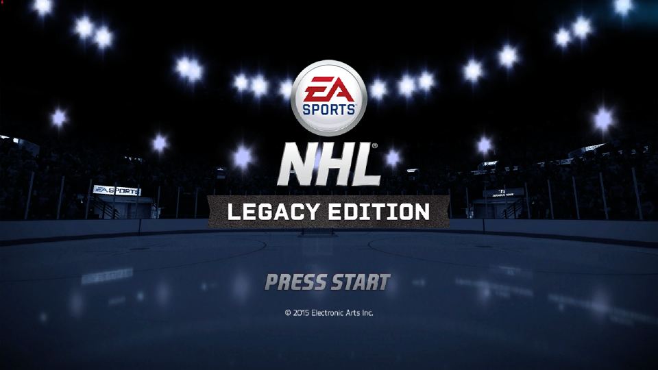
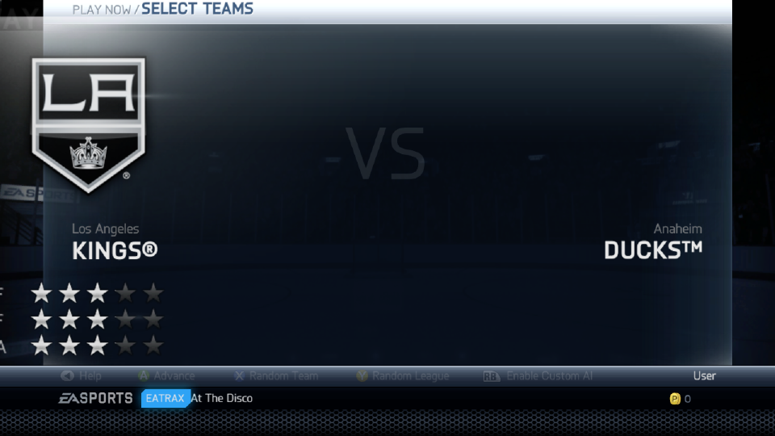
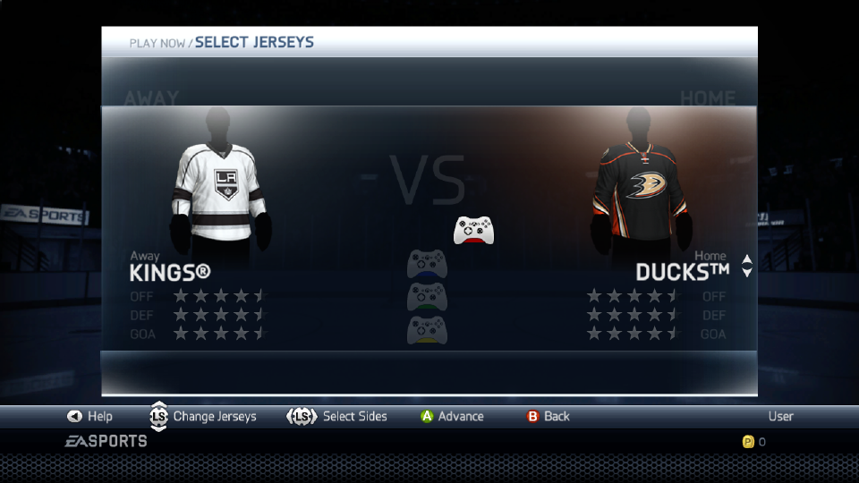
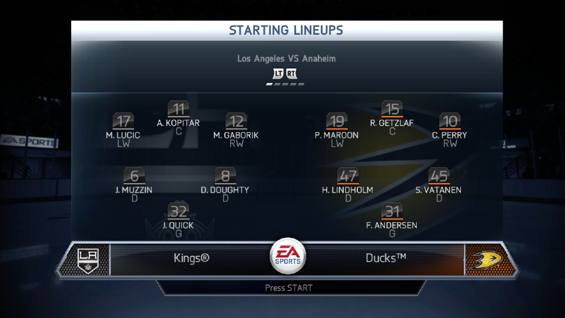
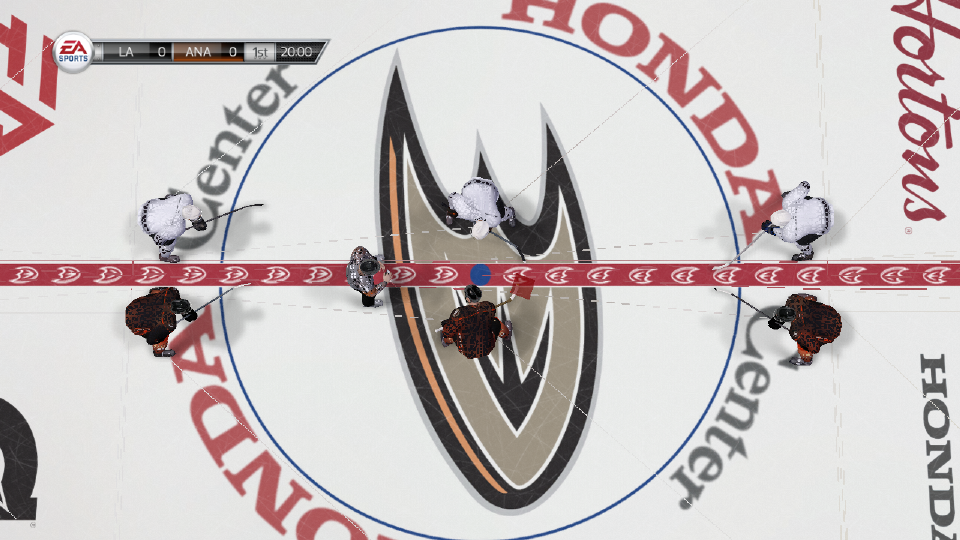
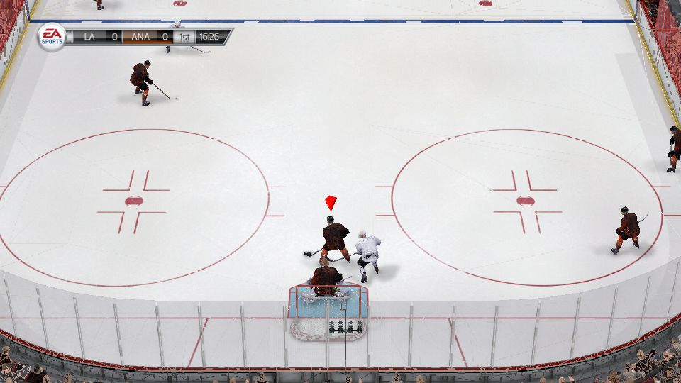
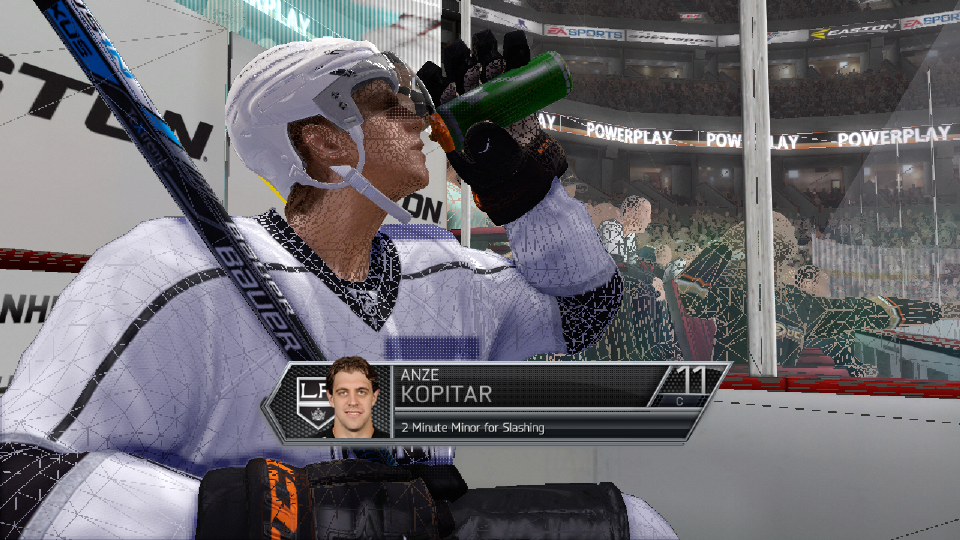

# NHL Legacy Recomp

A native **PC port of NHL Legacy** (Xbox 360), produced by static recompilation —
the original game's code is translated into a native Windows executable via RexGlue rather than
emulated, so it runs as a real PC application with modern rendering on top.

> ⚠️ **You must provide your own legally dumped copy of the game.** This project
> ships **no game content** of any kind. **Piracy is not condoned** — do not
> ask for, share, or use illegally obtained game files. This project is not
> affiliated with or endorsed by EA or Microsoft.

## This fork: native Linux + integrated-GPU performance

This fork adds a **native Linux build** (no Proton, no Wine) and makes the Vulkan renderer fast enough
for **integrated GPUs**. It is developed and measured on an Intel Core Ultra 5 225H mini PC (Arc iGPU),
streamed to a TV with Moonlight via [Games on Whales / Wolf](https://games-on-whales.github.io/).

| Gameplay, 1280x720, same scene | fps on the Arc iGPU |
|---|---|
| Upstream Vulkan path (fragment-shader-interlock EDRAM) | ~8–10 |
| This fork (host render targets + fixes below) | **~62–65 median, ~60 at the 5th percentile** |

What changed (each change is measured with A/B runs; details in [docs/nuc-perf-notes.md](docs/nuc-perf-notes.md)):

- **Host render targets work.** The fast `rtv` path rendered the 3D scene black. Root cause: the SDK's
  `execute_unclipped_draw_vs_on_cpu` defaulted to off (upstream Xenia: on), so the XDK's depth-clear quad
  claimed the whole EDRAM and destroyed the 3D colour buffer. With it on, `rtv` is correct and ~5x faster
  than the interlock path on this GPU. (The Tekken 6 recomp hit the same bug.)
- **Fewer wasted GPU copies.** EDRAM ownership transfers into areas the next draw provably overwrites (the
  XDK's 4x MSAA clear quads) are skipped — ported from The Simpsons Game recomp. Worst-case frame rate
  went from ~36 to ~60 fps.
- **No full re-upload of guest memory every frame** (`clear_memory_page_state=false`): +30 % median fps.
- **Every frame reaches the screen.** Any always-registered ImGui overlay forced the presenter to paint
  from the UI thread, which showed only every second frame. The Linux launcher presents directly.
- **Movies and transitions fixed.** The game image had no `ffmpeg` (green movies), and all movie players
  shared one decode stream (broken transition wipes, arena TV looping wipes).
- **Correct game speed above 30 fps:** the game clock is time-based, so the D3D presentation interval
  can be 0 (no hard 60 → 30 drops).
- **No memory leak on crash/kill:** guest memory in `/dev/shm` is unlinked right away (it used to leave
  ~5 GB per killed run).

All SDK changes are kept as patches in [`sdk/`](sdk/) on top of rexglue-sdk `c94f5eb`.

### Linux status

Playable from start to finish of a match. Known issues are tracked in
[docs/nuc-issues.md](docs/nuc-issues.md) (Steam overlay, a rare boot stall, some menu sounds).

### Building on Linux

You need your own dump of the game (see Legal). Ubuntu/Debian with clang-20:

```sh
git clone -b nuc-perf https://github.com/erik-131/nhl-legacy-recomp.git
cd nhl-legacy-recomp
# SDK + patches, toolchain and codegen: see tools/nuc/ct105/setup.sh and build.sh
tools/nuc/ct105/build.sh
```

The play launcher `tools/nuc/ct105/nhl_play.sh` sets the tested defaults. A Games on Whales setup
(Moonlight tiles, Steam shortcuts) is described in [docs/nuc-handoff.md](docs/nuc-handoff.md).

### Credits

Built on [puckhead73/nhl-legacy-recomp](https://github.com/puckhead73/nhl-legacy-recomp) and Redth's macOS
work, [rexglue-sdk](https://github.com/rexglue/rexglue-sdk) and [Xenia](https://xenia.jp/). The RT-transfer
work follows [The Simpsons Game recomp](https://github.com/YesterMester/TheSimpsonsGameRecomp).

## What you get

- **Native performance** — runs as a real Windows program (no emulator), at
  real-time framerates well above the original console.
- **Modern Vulkan renderer** with **AMD FidelityFX** (FSR upscaling / CAS
  sharpening), optional **supersampling**, and a live **color-grade** pass
  (exposure / contrast / saturation / white balance / tone mapping).
- **In-game overlay** — a settings panel, performance HUD, and display options
  (fullscreen / borderless, monitor select), toggled with a button on screen.
- **Loose-file friendly** — the installer unpacks the game's archives into a
  browsable file tree, so the community can inspect and replace assets.
- **Working in-game movies** — the VP6 intros / FMV are decoded on the host by a
  bundled `ffmpeg.exe` (the recompiled decoder had an arithmetic bug that garbled
  them); it ships beside the port and needs no setup.

## Screenshots

Captured from the Vulkan renderer at the game's native 1280x720 (macOS / Apple
Silicon build). No game content is included in this repository — these are
screenshots of the running port.

| | |
|---|---|
|  |  |
| Title screen | Team select |
|  |  |
| Jersey select | Starting lineups |
|  |  |
| Centre-ice faceoff | Gameplay |
|  | |
| Bench cam | |

## Requirements

- Windows 10 / 11, 64-bit (native), or **Linux / Steam Deck via Proton** — see
  **[docs/linux.md](docs/linux.md)**
- A **Vulkan-capable GPU**
- The [Microsoft Visual C++ Redistributable (x64)](https://aka.ms/vs/17/release/vc_redist.x64.exe)
  (Windows native; Proton usually provides this on Linux)
- ~10 GB free disk space
- **Your own dumped copy of NHL Legacy** — either a raw `.iso` of your disc, or an
  already-extracted game folder containing `default.xex`

## Getting started

1. Download the latest release zip from the
   [**Releases**](https://github.com/puckhead73/nhl-legacy-recomp/releases) page and
   extract it anywhere (keep the files together).
2. Run the builder with your own dump — either double-click
   `nhl-legacy-builder.exe` for prompts, or from a terminal:

   ```
   nhl-legacy-builder install --iso "C:\dumps\NHL Legacy.iso" --out "C:\Games\NHL Legacy"
   ```

   (Use `--from "C:\path\to\extracted folder"` instead of `--iso` if you already
   have an extracted game folder.)
3. Launch `nhllegacy.exe` from the output folder. No arguments needed.

To check that a dump is supported without doing a full install:

```
nhl-legacy-builder verify --iso "C:\dumps\NHL Legacy.iso"
```

The build is recompiled from one specific vanilla image of the game, so the builder
verifies your `default.xex` by hash. A different region, a modified dump, or one with
a title update applied will not pass validation.

### macOS (Apple Silicon)

The macOS port is built from source — see **[DEV-README.md](DEV-README.md)**.

**Just run it.** On first launch, if it cannot find game data, the app walks you
through setup: it explains what it needs, opens a native file picker for your
disc image, unpacks it with a progress bar, and remembers the location so this
only happens once. Xbox 360 discs are XDVDFS, so Finder, `hdiutil` and 7-Zip
cannot read them — the app does it for you. You can also point it at a folder
you have already unpacked.

To change the location later, open the in-game overlay (Guide button, or F1)
and use **Game data → Use a different disc or folder**, then relaunch.

There is a command-line equivalent for scripted setups:

```
tools/macos/setup_game.py --iso ~/Downloads/"NHL Legacy Edition.iso"
```

It takes `--from <folder>` for an already-unpacked dump, resumes if interrupted,
and prints the launch command when done. `NHL_NO_SETUP_UI=1` disables the
first-run dialog in the app for headless/CI use.

## Legal

You must own NHL Legacy and dump your own copy. No game assets are included or
distributed with this project, and none will be provided. This is a fan
preservation/portability effort, not affiliated with or endorsed by EA or Microsoft.
See `THIRD-PARTY-NOTICES.txt` in the release for bundled component licenses.

## Linux and Steam Deck

This fork builds **natively for Linux** — see "This fork" above. The Windows build also runs on Linux
through **Steam + Proton 11.0**. Community-tested
guides for playing an existing install and assembling one from a release zip + ISO
are in **[docs/linux.md](docs/linux.md)**.

## For developers

Building the port from source, the recompilation pipeline, the release process, and
architecture notes live in **[DEV-README.md](DEV-README.md)** and
**[docs/current-status.md](docs/current-status.md)**.
